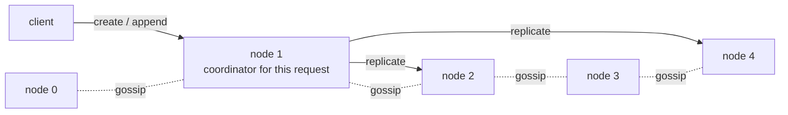

# aegisfs

aegisfs is a distributed file system written in C++20. It keeps three copies of each file on three
nodes, lets any node coordinate any request, and has no leader and no metadata server. One binary,
`aegisfs`, is both the storage node and the client.

It is a personal project built to work through how replicated storage, consistent hashing, gossip
membership and crash-safe writes fit together. It has been run as processes and containers on one
machine, not across separate hosts, and it is not meant for production use. Read
[Known limitations](#known-limitations) before relying on any of its guarantees.

## How it works



- **Placement.** File names and node ids are hashed with SHA-256 onto a 64-bit ring with 64 virtual
  points per node. A file lives on the first three distinct nodes after its position, so every node
  with the same membership view computes the same answer.
- **Membership.** SWIM-style gossip with `ALIVE`, `SUSPECT`, `FAILED` and `LEFT` states, incarnation
  numbers to override stale rumours, and indirect probes so one broken link does not remove a healthy
  node.
- **Storage.** A file is a base segment from `create` plus one immutable segment per `append`,
  listed in a checksummed manifest. Both are written to a staging directory, fsynced and renamed into
  place; recovery removes whatever a crash left uncommitted.
- **Writes.** The node the client contacts spools and hashes the upload and sends it to the
  replicas. A first attempt of `create` or `append` answers `OK` only when all three have committed,
  and `DEGRADED` with the count otherwise; a retry can answer `OK` with fewer replicas. Retries reuse
  the operation id, which a node applies at most once.
- **Reads.** `get` is served only by a replica that has the writes this client has had acknowledged,
  and answers `STALE` otherwise. `getQuorum` reads from a majority.
- **Ordering.** Appends are ordered by Lamport timestamp with a deterministic tie-break, so replicas
  converge. This is not wall-clock order and there is no linearizability claim.
- **Repair.** Nodes push missing segments to new replicas after a membership change, check stored
  segments against their checksums, and fetch good copies from peers.
- **Large files.** The client splits files above 256 MiB into chunk files that are placed
  independently, with a small index under the real name.
- **Security.** TLS and a shared cluster token are required unless `--insecure` is given.

The details are in [docs/architecture.md](docs/architecture.md).

## Build

Requires CMake 3.20 or newer, Ninja, a C++20 compiler, OpenSSL 3 and the `openssl` command line
tool. The first configure downloads GoogleTest; add `-DAEGISFS_BUILD_TESTS=OFF` to skip it. The code
uses POSIX sockets and is built on macOS and, in CI and the containers, Linux.

```
cmake -S . -B build -G Ninja -DCMAKE_BUILD_TYPE=RelWithDebInfo
cmake --build build
```

`scripts/bootstrap.sh` installs the packages with Homebrew or `apt-get` and then builds.

## Quick start

Start five nodes on loopback and store a file:

```
scripts/cluster.sh start 5
source scripts/devCreds.sh            # throwaway certificates and token for this shell
sleep 3                               # let membership converge

build/aegisfs --entry 127.0.0.1:9100 create README.md demo/readme
build/aegisfs --entry 127.0.0.1:9102 get demo/readme /tmp/readme.copy
build/aegisfs --entry 127.0.0.1:9100 ls demo/readme

scripts/cluster.sh stop
```

`scripts/demo.sh` runs a ten-node walkthrough that kills two replicas of a file, reads it back and
waits for repair.

## Commands

Run a node with `aegisfs serve --data <dir>`. Client commands take `--entry <host:port>`
(default `127.0.0.1:9100`) plus the credentials. Most print `key=value` lines. The exit code is 0 on
success and nonzero otherwise, usually the numeric status.

| Command | Description |
|---|---|
| `create <localfile> <name>` | store a new file; only the first create of a name succeeds |
| `append <localfile> <name>` | append to an existing file |
| `get <name> <localfile>` | read a file |
| `getQuorum <name> <localfile>` | read from a majority of replicas |
| `getFromReplica <addr> <name> <localfile>` | read one replica's copy |
| `merge <name>` | bring replicas to identical bytes and verify it |
| `ls <name>` | file id, replicas and which of them hold the file |
| `listStore` | files stored on the entry node |
| `listMemIds`, `members` | membership, the second with addresses |
| `multiAppend <name> <addr> <file> [<addr> <file> ...]` | concurrent appends through several nodes |
| `status`, `health`, `metrics` | node state and counters |
| `leave` | hand off data and leave the cluster |
| `shell`, `help`, `version` | interactive prompt, usage, version |

`--stripe-mib N` sets the striping threshold (0 turns it off). File names are relative, may contain
`/`, and may not contain `.` or `..` components or control characters. aegisfs has no delete or
rename operation.

Node flags, credentials, Docker Compose, the REST gateway and the Prometheus exporter are covered in
[docs/operations.md](docs/operations.md).

## Optional integrations

`aegisfs-integrations` can index file metadata in Cassandra and copy files to and from HDFS over
WebHDFS with SHA-256 verification. Neither is needed by the cluster. See
[docs/integrations/overview.md](docs/integrations/overview.md).

## Testing

```
ctest --test-dir build --output-on-failure     # unit, integration, concurrency and chaos tests
python3 tests/extensions/testExtensions.py     # gateway and exporter
scripts/checks/smokeTest.sh                    # three local nodes end to end
scripts/checks/reliabilityTest.sh              # two node failures, bad frames, bad credentials
scripts/checks/sanitizerTest.sh asan           # or tsan
scripts/checks/composeSmokeTest.sh             # ten containers (Docker)
scripts/checks/networkFaultTest.sh             # partition, loss, latency, one-way link (Docker)
```

The Python code needs Python 3.9 or newer. `make verify` runs a build, the C++ and extension
tests, the smoke test, the demo and the reliability test. The C++ tests start real nodes inside one
process and talk over TCP; crash points in the storage write path are injected directly.
[docs/invariants.md](docs/invariants.md) maps each intended property to the test that checks it. CI
also runs AddressSanitizer, a ThreadSanitizer subset and the two Compose checks.

## Performance

Historical measurement on one Apple M3 laptop: five local nodes, three replicas, TLS off, 100 MiB
`create`, 40 samples per build, comparing two builds before and after four write-path changes.

| 100 MiB `create` | Before | After |
|---|---|---|
| Median | 496 ms | 254 ms |
| p95 | 1254 ms | 294 ms |

These are loopback numbers from a busy machine and are only useful relative to each other. Method,
raw data and further results are in [docs/benchmarks.md](docs/benchmarks.md).

## Known limitations

Correctness:

- Appends from different clients are ordered by Lamport timestamp and a deterministic tie-break;
  this is not wall-clock order or linearizability. Repair and hand-off remain asynchronous.
- The client retries a `DEGRADED` write, and the retry can answer `OK` although only one replica
  holds an append. A later `get` by the same client can then omit that acknowledged append.
- An append retried while the first replica is unreachable gets a second Lamport time. With another
  append in between, replicas can store the two in different orders, and `merge` then returns
  `CONFLICT`.

Security (details in [SECURITY.md](SECURITY.md)):

- TLS handshakes are performed on the accept thread and bounded by a one-second socket timeout. An
  idle connection can still occupy that thread briefly, but cannot block acceptance indefinitely.
- One shared token grants every operation. Data is not encrypted at rest.

Scope and scale:

- No delete, rename or per-file permissions.
- Only containers and processes on one machine have been tested.
- Repair asks the other replicas for a manifest for every stored file about once a second.
- A replica holds one whole segment in memory while serving a read, and verifies the file by reading
  it once before sending it.
- A segment is spooled completely before the coordinator forwards it.

[docs/tradeoffs.md](docs/tradeoffs.md) explains the main design choices.

## Repository layout

| Path | Contents |
|---|---|
| `include/aegisfs/`, `src/` | library, node and client |
| `tests/` | C++ tests by kind, tests for the extensions and integrations |
| `scripts/` | local cluster, demo, checks, integration helpers |
| `deploy/docker/` | Dockerfiles and Compose files |
| `extensions/` | REST gateway, metrics exporter, optional integrations |
| `benchmarks/` | benchmark scripts and recorded results |
| `docs/` | architecture, invariants, trade-offs, operations, benchmarks, integrations |

## License

[MIT](LICENSE)
