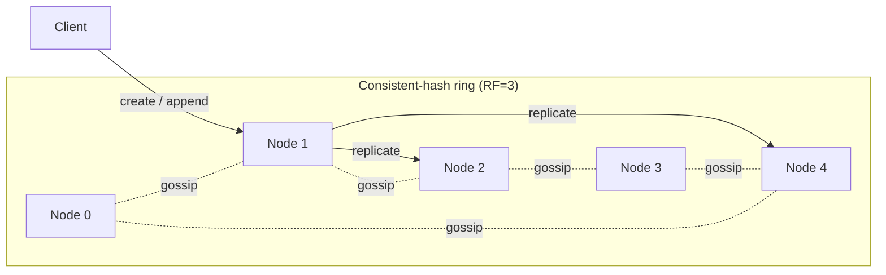

# AegisFS

[](https://github.com/sushildalavi/aegisfs/actions/workflows/ci.yml)


**AegisFS** is a coordinator-free distributed file system written in C++20. It combines
consistent-hash placement, gossip membership, replicated storage, crash-safe manifests, and
automatic repair behind a single binary that acts as both storage node and client.

The project is an independent implementation inspired by public ideas from HDFS, Cassandra, SWIM,
and HyDFS. It is not a fork or port of any of those systems.

## Features

- Deterministic SHA-256 placement on a 64-bit virtual-node consistent-hash ring.
- RF=3 replication across the first three distinct ring successors — no single point of failure.
- SWIM-inspired gossip membership with suspicion, incarnation numbers, and tombstone cleanup.
- Immutable base/append segments with checksummed, atomically committed manifests (stage → fsync
  → rename), crash-safe across process restarts.
- Per-client append ordering, idempotent operation IDs, read-your-writes, and merge convergence.
- Automatic re-replication, safe handoff on node departure, and anti-entropy repair in the
  background.
- Bounded streaming transfers (constant memory regardless of file size), client retries, quorum
  reads, optional TLS/mTLS, a REST gateway, and Prometheus metrics.

## Architecture

A client's write fans out to the three nodes that own a file on the ring; a read is served by the
first reachable owner whose manifest satisfies the client's read-your-writes watermark.



Any node can act as the coordinator for a given request. There is no leader, no external
coordination service, and no single point of failure: placement is a pure function of the
consistent-hash ring, and membership is learned entirely through gossip.

| Stage | What happens |
|---|---|
| Write | Coordinator computes the file's 3 ring successors, fans the segment out to all of them, and acknowledges only once every replica has durably committed (fsync + atomic rename). |
| Read | Coordinator picks the first reachable replica whose manifest meets the client's watermark and streams the reconstructed file back in bounded chunks. |
| Failure | Peers detect a dead node through gossip and push its replicas to new ring successors; anti-entropy repairs corrupted segments in the background. |
| Recovery | A restarted or rejoining node reclaims its ring position, garbage-collects any uncommitted segments, and catches up via anti-entropy. |

See [`docs/architecture.md`](docs/architecture.md) for the full component breakdown and request
paths.

## Status

| Check | Result |
|---|---|
| C++ build | Pass |
| Full test suite (`ctest`) | 93/93 pass |
| AddressSanitizer build | 60/60 pass |
| Python extension & operation-history tests | 6/6 pass |
| Benchmark result validation | 80 rows pass |
| Docker Compose validation | Not run (requires a host with Docker installed) |

## Benchmarks

Measured on a 5-node process-local cluster over loopback TCP, replicating every write to 3
replicas before acknowledging. Full methodology and raw data: [`docs/benchmarks.md`](docs/benchmarks.md).

**Throughput by payload size** (`create`, parallel replica fan-out):

```
  1 KiB  │▏                                                   0.02 MB/s
  1 MiB  │████                                                 16.1 MB/s
 10 MiB  │█████████████████████                                78.5 MB/s
100 MiB  │██████████████████████████████████████████████████  189.3 MB/s
```

**Sequential vs. parallel replica fan-out** (100 MiB `create`, mean latency):

| Fan-out | Latency | Throughput |
|---|---|---|
| Sequential | 647 ms | 157.0 MB/s |
| Parallel | 541 ms | 189.3 MB/s |
| **Improvement** | **−16%** | **+21%** |

## Build

Requirements: CMake 3.20+, Ninja, a C++20 compiler, OpenSSL 3, and Python 3 for extension tests.
GoogleTest is fetched automatically by CMake.

```bash
cmake -S . -B build -G Ninja -DCMAKE_BUILD_TYPE=RelWithDebInfo
cmake --build build
```

Run the full test suite:

```bash
ctest --test-dir build --output-on-failure
```

## Quick start

```bash
# Launch a 10-node process-local cluster
scripts/cluster.sh start 10

# Create, inspect, and read a file from a different node than it was written on
printf 'hello\n' >/tmp/hello.txt
./build/aegisfs --entry 127.0.0.1:9100 create /tmp/hello.txt notes/hello.txt
./build/aegisfs --entry 127.0.0.1:9100 ls notes/hello.txt
./build/aegisfs --entry 127.0.0.1:9103 get notes/hello.txt /tmp/back.txt

scripts/cluster.sh stop
```

Fault-injection demo (kills 2 of 10 nodes mid-run and verifies re-replication):

```bash
scripts/demo.sh
```

## CLI reference

| Command | Purpose |
|---|---|
| `create <local> <name>` | Create a file; the first successful create wins |
| `get <name> <local>` | Read a file with checksum verification |
| `getQuorum <name> <local>` | Read from a majority of replicas and select the highest version |
| `append <local> <name>` | Append bytes with per-client ordering |
| `merge <name>` | Reconcile reachable replicas to one byte-identical view |
| `ls <name>` | Show file metadata and designated replicas |
| `listStore` | List files stored on the entry node |
| `getFromReplica <addr> <name> <local>` | Read one specific replica without read repair |
| `listMemIds` | List members, states, incarnation numbers, and ring IDs |
| `multiAppend <name> <node> <file> [...]` | Issue concurrent appends from multiple nodes |
| `status` / `health` | Inspect node state or liveness |

## Consistency and failure model

- A file with three healthy durable replicas remains readable after up to **two node failures**.
- Healthy writes acknowledge only after all three replicas durably commit.
- Writes with fewer reachable replicas return `DEGRADED` and expose the committed count — never a
  silent partial success.
- A read that cannot satisfy the client's read-your-writes watermark returns `STALE` rather than
  serving stale bytes.
- Ring routing is `O(log N)` binary search over virtual nodes — stated honestly, not claimed O(1).

## Project layout

```
aegisfs/
├── src/            core implementation (ring, gossip, storage, replication, networking, CLI)
├── include/        public headers
├── tests/
│   ├── unit/           hash, ring, protocol, manifest, storage, membership, net, metrics
│   ├── integration/    multi-node cluster and replication behavior
│   ├── concurrency/    ordering and race tests under load
│   ├── chaos/          failure, recovery, and repair tests
│   └── python/         extension and operation-history checks
├── extensions/
│   ├── gateway/        REST gateway with bearer-token auth
│   └── metrics/        Prometheus exporter + Grafana starter dashboard
├── scripts/        cluster, smoke, demo, reliability, and sanitizer runners
├── benchmarks/     reproducible benchmark runner and recorded results
└── docs/           architecture, invariants, tradeoffs, operations, benchmarks, FAQ
```

- [`docs/architecture.md`](docs/architecture.md) — system components and request paths.
- [`docs/invariants.md`](docs/invariants.md) — correctness invariants mapped to tests.
- [`docs/tradeoffs.md`](docs/tradeoffs.md) — design choices and alternatives considered.
- [`docs/operations.md`](docs/operations.md) — operating and recovery runbook.
- [`docs/benchmarks.md`](docs/benchmarks.md) — benchmark methodology and measurements.
- [`docs/designFaq.md`](docs/designFaq.md) — design questions and answers.
- [`docs/extensions.md`](docs/extensions.md) — TLS, REST, Prometheus, Grafana, and Compose.

## License

MIT — see [`LICENSE`](LICENSE).
