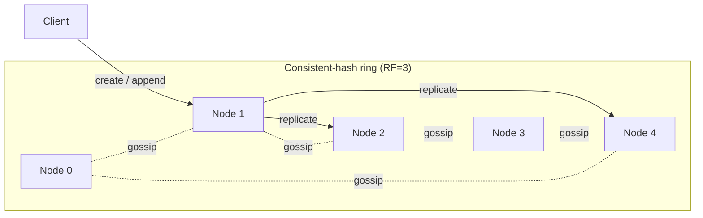

# AegisFS

[](https://github.com/sushildalavi/aegisfs/actions/workflows/ci.yml)


**AegisFS** is a coordinator-free distributed file system written in C++20: consistent-hash
placement, gossip membership, RF=3 replication, crash-safe manifests, and automatic repair,
behind a single binary that acts as both storage node and client.

Independent implementation inspired by public ideas from HDFS, Cassandra, SWIM, and HyDFS — not a
fork or port of any of them.

## Architecture

A write fans out to the three nodes that own a file on the ring; a read is served by the first
reachable owner whose manifest satisfies the client's read-your-writes watermark. Any node can
coordinate a request — no leader, no external coordination service.



A dead node is detected through gossip and its replicas are re-placed on new ring successors;
anti-entropy repairs corrupted segments in the background. Full breakdown:
[`docs/architecture.md`](docs/architecture.md).

## Features

- SHA-256 placement on a 64-bit virtual-node consistent-hash ring; RF=3 across the first three
  distinct successors.
- SWIM-inspired gossip membership with suspicion, incarnation numbers, and tombstone cleanup.
- Immutable segments with checksummed manifests committed atomically (stage → fsync → rename).
- Per-client append ordering, idempotent operation IDs, read-your-writes, and merge convergence.
- Automatic re-replication, safe handoff, and anti-entropy repair.
- Bounded streaming I/O, client retries, quorum reads, optional TLS/mTLS, a REST gateway, and
  Prometheus metrics.

## Status

| Check | Result |
|---|---|
| Full test suite (`ctest`) | 93/93 pass |
| AddressSanitizer build | 60/60 pass |
| Python extension & operation-history tests | 6/6 pass |
| Benchmark result validation | 80 rows pass |
| Docker Compose validation | Not run (requires a host with Docker installed) |

## Benchmarks

5-node process-local cluster, loopback TCP, every write replicated 3x before acknowledging.
Methodology and raw data: [`docs/benchmarks.md`](docs/benchmarks.md).

| Fan-out (100 MiB `create`) | Latency | Throughput |
|---|---|---|
| Sequential | 647 ms | 157 MB/s |
| Parallel | 541 ms | 189 MB/s |

## Build & run

Requirements: CMake 3.20+, Ninja, a C++20 compiler, OpenSSL 3, Python 3. GoogleTest is fetched
automatically.

```bash
cmake -S . -B build -G Ninja -DCMAKE_BUILD_TYPE=RelWithDebInfo
cmake --build build
ctest --test-dir build --output-on-failure
```

```bash
scripts/cluster.sh start 10                              # launch a 10-node cluster
./build/aegisfs --entry 127.0.0.1:9100 create local.txt notes/a.txt
./build/aegisfs --entry 127.0.0.1:9103 get notes/a.txt out.txt   # read from a different node
scripts/demo.sh                                           # fault-injection demo
scripts/cluster.sh stop
```

## CLI reference

| Command | Purpose |
|---|---|
| `create <local> <name>` | Create a file; the first successful create wins |
| `get <name> <local>` | Read a file with checksum verification |
| `getQuorum <name> <local>` | Read from a majority of replicas, highest version wins |
| `append <local> <name>` | Append bytes with per-client ordering |
| `merge <name>` | Reconcile replicas to one byte-identical view |
| `ls <name>` | Show file metadata and designated replicas |
| `listMemIds` | List members, states, and ring IDs |
| `status` / `health` | Inspect node state or liveness |

## Consistency model

- Readable after up to **two node failures**, given three healthy replicas beforehand.
- Writes acknowledge only once all three replicas durably commit; a degraded write returns
  `DEGRADED` with the committed count, never a silent partial success.
- A read that can't meet the client's watermark returns `STALE` rather than stale bytes.
- Ring routing is `O(log N)`, not O(1).

## Project layout

```
src/            core implementation
include/        public headers
tests/          unit, integration, concurrency, chaos, python
extensions/     REST gateway, Prometheus/Grafana
scripts/        cluster, smoke, demo, reliability, sanitizer runners
benchmarks/     runner + recorded results
docs/           architecture, invariants, tradeoffs, operations, benchmarks, FAQ
```

## License

MIT — see [`LICENSE`](LICENSE).
