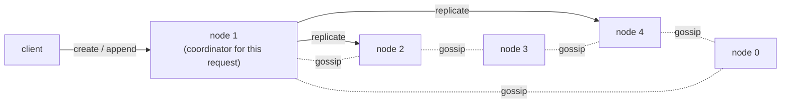

# AegisFS

[](https://github.com/sushildalavi/aegisfs/actions/workflows/ci.yml)


## What it is

AegisFS is a distributed file system written in C++20. You give it a file, and it keeps three copies
on three different machines. Any machine in the cluster can take a request, and there is no leader and
no metadata server to ask where things live. If two of a file's three copies are lost, the file is
still readable, and the cluster rebuilds the missing copies on its own.

It is one binary. The same `aegisfs` runs as a storage node (`aegisfs serve`) and as the client
(`aegisfs create`, `get`, `append`, ...). The design borrows from HDFS (replicated storage), Cassandra
(ring placement, gossip) and HyDFS (the command set), but it shares no code with any of them. It
started as a way to work through how those systems fit together, and it is a personal project, not
something to run in production.

## How it works



**Placement.** Nodes and file names are hashed with SHA-256 onto a 64-bit ring, with 64 virtual
nodes per physical node. A file lives on the first three distinct nodes at or after its position.
Lookup is a binary search, so O(log N). Every node computes the same answer from its own
membership view, so no one has to be asked where a file is.

**Membership.** Gossip in the style of SWIM. Nodes exchange member tables, probe each other, and move
peers through `ALIVE`, `SUSPECT`, `FAILED` and `LEFT`. Incarnation numbers stop stale rumours from
reviving a dead node, and a suspected node can refute the rumour. Before suspecting a peer, a node
asks others to probe it too, so one broken link doesn't get a healthy node declared dead.

**Storage.** A file is an immutable base segment from `create` plus one immutable segment per
`append`, described by a checksummed manifest. Segments and manifests are written to a staging
directory, fsynced, then renamed into place. A crash between those steps leaves nothing the
manifest points to, and recovery sweeps up the rest.

**Writes.** The node a client talks to coordinates that one request. It spools and hashes the upload,
assigns an operation id and a Lamport timestamp, and sends the segment to the three replicas. Each
operation id is applied at most once, so a retry is safe. `create` and `append` return `OK` only when
all three replicas have fsynced and committed. If fewer did, or the ring has fewer than three
members, the status is `DEGRADED` along with the number that committed.

**Reads.** A client remembers the newest write the cluster acknowledged for each file. `get` only
accepts a replica that has that write, and if none does it answers `STALE` instead of returning old
bytes. `getQuorum` reads from a majority and uses the newest result.

**Ordering.** One client's appends keep their order on every replica. Appends from different clients
end up in a single deterministic order decided by Lamport timestamps, so replicas converge once things
go quiet. That order is not wall-clock time, and there is no linearizability claim. `merge` brings the
replicas to one identical state and returns `OK` only if they are byte-identical, `CONFLICT` otherwise.

**Repair.** If a node fails, the survivors notice, work out the new replica set and push any missing
data to the new members. A node that stops being a replica only deletes its copy after the new
replicas confirm they have everything. A background pass also checks segments against their
checksums and repairs bad ones from a healthy peer.

More detail is in [docs/architecture.md](docs/architecture.md), and
[docs/designFaq.md](docs/designFaq.md) covers the reasoning behind the choices.
[docs/invariants.md](docs/invariants.md) lists each property the code is meant to hold and the test
that checks it.

## Performance

Measured on one Apple M3 laptop with five nodes on loopback, replication factor 3, fsync on, and
every write checked on all three replicas before it is acknowledged.

| 100 MiB `create` | before | after |
|---|---|---|
| median | 312 ms | 199 ms (-36%) |
| p95 | 463 ms | 260 ms (-44%) |
| throughput at the median | 332 MB/s | 528 MB/s |

"Before" is commit `399efb5`, "after" is the current tree, each on a fresh cluster, alternated over
four rounds with 40 samples per build. Two changes account for it: replicas now rename the spooled
upload into place instead of copying it, and the background integrity check no longer re-hashes every
stored segment every second. A 40% cut in the median was the goal and I did not reach it; what is
left is the sequence of full passes over the data, which would need data forwarded to replicas
while it is still arriving. The page [docs/benchmarks.md](docs/benchmarks.md) has the method, the
other measurements and the caveats, including that this is one machine and loopback only.

## Layout

```
src/, include/aegisfs/   node, client, ring, membership, storage, protocol
tests/                   unit, integration, concurrency, chaos, python
scripts/                 cluster launcher and demo; scripts/checks has the verification scripts
benchmarks/              benchmark scripts and recorded results
deploy/docker/           Dockerfiles and compose file
extensions/              REST gateway, Prometheus exporter and Grafana dashboard
docs/                    architecture, invariants, tradeoffs, operations, benchmarks, FAQ
```

## Building

You need CMake 3.20 or newer, Ninja, a C++20 compiler (clang or gcc), OpenSSL 3 and Python 3.
GoogleTest is downloaded by CMake. `scripts/bootstrap.sh` installs the dependencies on macOS
(Homebrew) and Debian or Ubuntu.

```bash
cmake -S . -B build -G Ninja && cmake --build build
scripts/demo.sh        # starts ten local nodes and walks through the features
```

Run `aegisfs help` for the client commands. A node takes `--data`, `--port`, `--seeds`, `--rf`, and
optional TLS flags; see [docs/operations.md](docs/operations.md).

## License

MIT. See [LICENSE](LICENSE).
