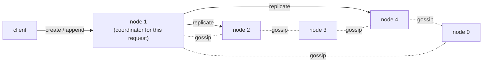

# AegisFS

[](https://github.com/sushildalavi/aegisfs/actions/workflows/ci.yml)


AegisFS is a distributed file system written in C++20. Every file is stored on three nodes chosen by
a consistent-hash ring, any node can accept a request, and there is no leader or metadata server.
It survives losing two of a file's three replicas and repairs itself afterwards.

It is one binary: the same `aegisfs` runs as a storage node (`aegisfs serve`) and as the client
(`aegisfs create`, `get`, `append`, ...). The design borrows from HDFS (replicated storage),
Cassandra (ring placement, gossip) and HyDFS (the command set), but it shares no code with any of
them. It started as a way to work through how those systems fit together, and it is a personal
project, not something to run in production.

## A quick look

```bash
cmake -S . -B build -G Ninja && cmake --build build
scripts/cluster.sh start 10                       # ten nodes on 127.0.0.1:9100-9109

./build/aegisfs --entry 127.0.0.1:9100 create report.pdf docs/report.pdf
./build/aegisfs --entry 127.0.0.1:9107 get docs/report.pdf copy.pdf     # a different node
./build/aegisfs --entry 127.0.0.1:9100 ls docs/report.pdf               # which three nodes hold it
./build/aegisfs --entry 127.0.0.1:9100 listMemIds                       # ring and membership view

scripts/cluster.sh kill 3                         # kill nodes, then read the file again
scripts/cluster.sh stop
```

`scripts/demo.sh` does the whole tour against ten nodes and asserts as it goes: replicated create,
concurrent appends, merge, reading after two nodes are killed, and re-replication.

## How it works



**Placement.** Nodes and file names are hashed with SHA-256 onto a 64-bit ring, with 64 virtual
nodes per physical node. A file lives on the first three distinct nodes at or after its position.
Lookup is a binary search, so O(log N). Every node computes the same answer from its own
membership view, so no one has to be asked where a file is.

**Membership.** Gossip in the style of SWIM. Nodes exchange member tables, probe each other, and move
peers through `ALIVE`, `SUSPECT`, `FAILED` and `LEFT`. Incarnation numbers stop stale rumours from
reviving a dead node, and a suspected node can refute the rumour. Before suspecting a peer, a node
asks others to probe it too, so one broken link doesn't get a healthy node declared dead.

**Storage.** A file is an immutable base segment from `create` plus one immutable segment per
`append`, described by a checksummed manifest. Segments and manifests are written to a staging
directory, fsynced, then renamed into place. A crash between those steps leaves nothing the
manifest points to, and recovery sweeps up the rest.

**Writes.** The node a client talks to coordinates that one request. It spools and hashes the upload,
assigns an operation id and a Lamport timestamp, and sends the segment to the three replicas. Each
operation id is applied at most once, so a retry is safe.

**Repair.** If a node fails, the survivors notice, work out the new replica set and push any missing
data to the new members. A node that stops being a replica only deletes its copy after the new
replicas confirm they have everything. A background pass also checks segments against their
checksums and repairs bad ones from a healthy peer.

More detail is in [docs/architecture.md](docs/architecture.md), and
[docs/designFaq.md](docs/designFaq.md) covers the reasoning behind the choices.

## What it guarantees

- A file that had three healthy replicas stays readable after two node failures.
- `create` and `append` return `OK` only when all three replicas have fsynced and committed. If
  fewer than three did, or the ring has fewer than three members, they return `DEGRADED` with the
  number that committed.
- `get` returns a client's own acknowledged writes. If no reachable replica has them yet, it returns
  `STALE` rather than old bytes.
- A client's appends keep their order on every replica. Appends from different clients end up in one
  deterministic order, decided by Lamport timestamps, so all replicas converge once things go quiet.
  That order is not wall-clock time, and the system makes no linearizability claim.
- Only the first `create` of a name wins, even when several clients race.
- `merge` returns `OK` only if every reachable replica ends up byte-identical, and `CONFLICT`
  otherwise.

## Performance

Measured on one Apple M3 laptop with five nodes on loopback, replication factor 3, fsync on, and
every write checked on all three replicas before it is acknowledged.

| 100 MiB `create` | before | after |
|---|---|---|
| median | 312 ms | 199 ms (-36%) |
| p95 | 463 ms | 260 ms (-44%) |
| throughput at the median | 332 MB/s | 528 MB/s |

"Before" is commit `399efb5`, "after" is the current tree, each on a fresh cluster, alternated over
four rounds with 40 samples per build. Two changes account for it: replicas now rename the spooled
upload into place instead of copying it, and the background integrity check no longer re-hashes every
stored segment every second. A 40% cut in the median was the goal and I did not reach it; what is
left is the sequence of full passes over the data, which would need data forwarded to replicas
while it is still arriving. The page [docs/benchmarks.md](docs/benchmarks.md) has the method, the
other measurements and the caveats, including that this is one machine and loopback only.

## Testing

`ctest` runs 97 tests: unit tests for the ring, hashing, protocol, manifests, storage and membership;
integration tests that start real nodes on separate localhost ports; concurrency and stress tests;
and chaos tests that kill, restart, partition and corrupt nodes.

```bash
ctest --test-dir build --output-on-failure
scripts/checks/smokeTest.sh          # three real processes, end to end
scripts/checks/reliabilityTest.sh    # two-node failure and malformed frames against live processes
scripts/checks/sanitizerTest.sh asan # or tsan
make verify                           # build, tests, smoke, demo, reliability in one go
```

CI builds on Linux with clang, runs the suite plain and under AddressSanitizer, and runs the
concurrency and membership tests under ThreadSanitizer. [docs/invariants.md](docs/invariants.md)
lists each property the code is meant to hold and the test that checks it.

## What is not done

- There are no tests with a real network fault tool (packet loss, delay, one-way links). The
  partition tests make a peer unreachable inside the test process.
- Crashes are tested at the point between writing a segment and committing its manifest, but not at
  every step of the write path.
- The Docker files in `deploy/docker/` have never been run, because I developed on a machine
  without Docker.
- Everything has been measured on a single machine. I have not run it across real hosts.
- Transport security (TLS and mutual TLS) is optional and off by default, and the binary protocol
  has no authorization. See [SECURITY.md](SECURITY.md).
- Each file lives on exactly three nodes; there is no striping of one large file across many.

## Layout

```
src/, include/aegisfs/   node, client, ring, membership, storage, protocol
tests/                   unit, integration, concurrency, chaos, python
scripts/                 cluster launcher and demo; scripts/checks has the verification scripts
benchmarks/              benchmark scripts and recorded results
deploy/docker/           Dockerfiles and compose file
extensions/              REST gateway, Prometheus exporter and Grafana dashboard
docs/                    architecture, invariants, tradeoffs, operations, benchmarks, FAQ
```

## Building

You need CMake 3.20 or newer, Ninja, a C++20 compiler (clang or gcc), OpenSSL 3 and Python 3.
GoogleTest is downloaded by CMake. `scripts/bootstrap.sh` installs the dependencies on macOS
(Homebrew) and Debian or Ubuntu.

## Commands

| Command | What it does |
|---|---|
| `create <local> <name>` | Store a new file. Fails if the name exists. |
| `get <name> <local>` | Read a file, verifying checksums. |
| `getQuorum <name> <local>` | Read from a majority of replicas and use the newest. |
| `append <local> <name>` | Append bytes to an existing file. |
| `merge <name>` | Bring all replicas to one identical state. |
| `ls <name>` | Show the file id and which nodes hold it. |
| `getFromReplica <addr> <name> <local>` | Read one replica without repairing anything. |
| `listMemIds` | List members with their ring ids and states. |
| `listStore` | List the files stored on the node you ask. |
| `status`, `health` | Node state and liveness. |

Run `aegisfs help` for the full list. A node takes `--data`, `--port`, `--seeds`, `--rf`, and optional
TLS flags; see [docs/operations.md](docs/operations.md).

## License

MIT. See [LICENSE](LICENSE).
