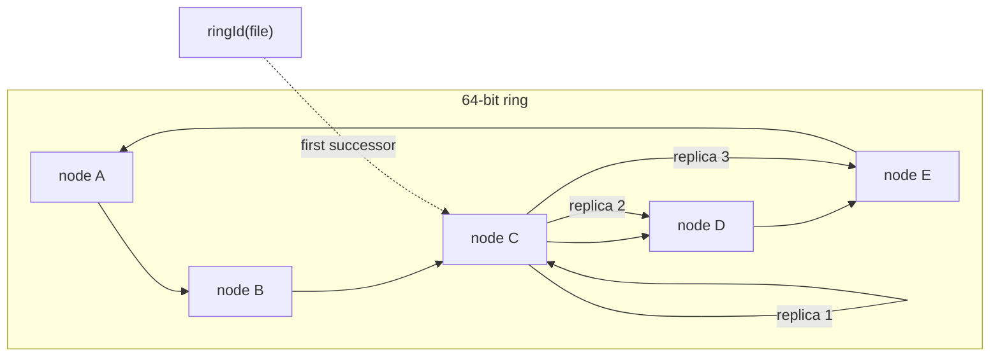
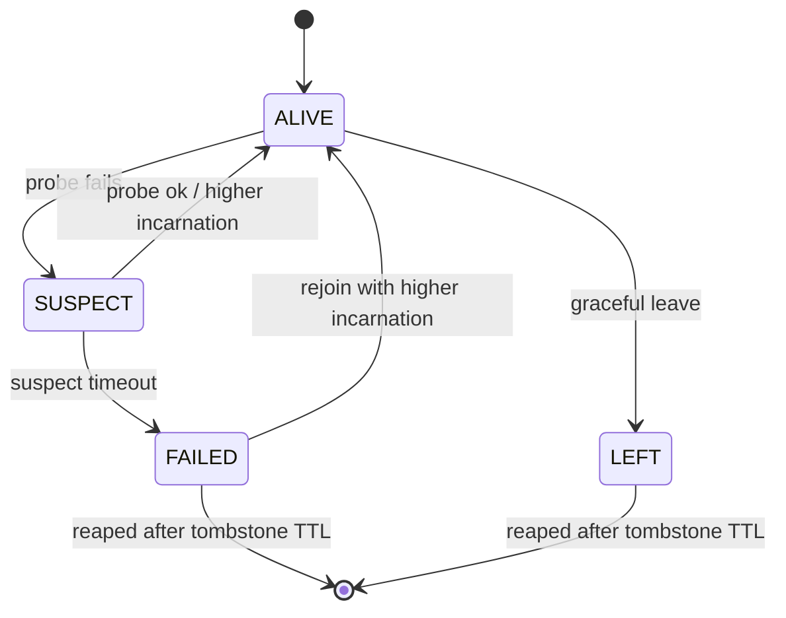

# AegisFS Architecture

AegisFS is a fault-tolerant distributed file system. It borrows replicated storage from HDFS and
consistent-hash placement and gossip membership from Cassandra, and its command set follows HyDFS.
It is not a port of any of them.

## 1. Components

Every process is a single `aegisfs` binary that is simultaneously:

```
+---------------------------------------------------------------+
|                         aegisfs node                          |
|                                                               |
|  CLI / client  ->  Client lib  ->  (TCP, length-framed RPC)   |
|                                                               |
|  RPC server (bounded thread pool)                             |
|    ├─ Membership   (gossip + suspicion, incarnation numbers)  |
|    ├─ Ring         (consistent hash, first-3 successors)      |
|    ├─ Storage      (immutable base + append segments)         |
|    ├─ Manifest     (per-file metadata, atomic commit)         |
|    ├─ Replication  (coordinator-per-write, anti-entropy)      |
|    └─ Metrics      (counters, latency histograms)             |
+---------------------------------------------------------------+
```

- **Client lib** turns CLI commands into RPCs. Any node can serve as the entry point; it routes
  to the correct replica set using its local ring + membership view.
- **RPC server** accepts length-framed requests, dispatches on a bounded `ThreadPool`, and streams
  large payloads in bounded chunks (default 1 MiB) so 100+ MiB files never load fully into RAM.
- **Membership** maintains the cluster view and disseminates changes.
- **Ring** maps node IDs and filenames onto a 64-bit identifier space derived from SHA-256.
- **Storage/Manifest** own the crash-safe on-disk layout.
- **Replication** coordinates writes across the 3 designated replicas and repairs divergence.

## 2. Identifiers and the ring

- `ringId(x) = top 64 bits of SHA-256(x)`. Used for both node IDs (`SHA-256(host:port:nodeuuid)`)
  and file IDs (`SHA-256(filename)`). We **never** use `std::hash` for persistent cross-process IDs.
- The ring is the sorted set of live member ring IDs. For a filename `f`, the **primary** is the
  first node whose ring ID ≥ `ringId(f)` (wrapping around), and replicas are the next 2 **distinct**
  successors. Default replication factor **RF = 3**.
- Lookup is a binary search over the sorted ring: **O(log N)** per query, not O(1).

## 3. On-disk layout

```
<dataDir>/
  node.id                      # persisted node identity (uuid, ring id)
  membership.snapshot          # last known membership (for faster rejoin)
  files/<fileId>/
    manifest                   # binary manifest (atomic-committed)
    base.seg                   # immutable base segment (from create)
    append-<opid>.seg          # one immutable segment per committed append
  journal/                     # write-ahead intent records for in-flight ops
  tmp/                         # staging for fsync+rename; cleaned on recovery
```

### Manifest (per logical file)
`filename, fileId, createOpId, version/epoch, [segment refs: {kind, opId, clientId,
clientSeq, lamportTs, size, sha256}], replica_state`. Serialized with explicit length-prefixed
fields and a trailing CRC; written to `tmp/` then `fsync`+`rename`d over the live manifest.

## 4. RPC protocol (length-framed, binary-safe)

Frame = `MAGIC(4) | VERSION(2) | TYPE(2) | HEADER_LEN(4) | HEADER | PAYLOAD_LEN(8) | PAYLOAD`.

- All integers little-endian, explicit bounds-checked on read. Max header/payload sizes enforced.
- HEADER is a compact TLV of typed fields (ints, strings, bytes). PAYLOAD carries file bytes and is
  streamed in `CHUNK` frames for large transfers.
- Request types: `PING, MEMBERSHIP, CREATE, GET, APPEND, MERGE, LS, LISTSTORE, GET_FROM_REPLICA,
  LIST_MEM_IDS, REPLICATE_PUT, REPLICATE_APPEND, FETCH_MANIFEST, FETCH_SEGMENT, ANTI_ENTROPY, STATUS`.

## 5. Write path (create / append)

1. Client sends `CREATE`/`APPEND` to any node → that node is the **operation coordinator** (temporary,
   per-op; not a cluster leader).
2. Coordinator computes the 3 replicas from `ringId(filename)`.
3. Coordinator assigns an **operation id** = `(clientId, clientSeq, lamportTs)`; `lamportTs` is a
   monotonic logical clock advanced on every op the coordinator sees.
4. Coordinator writes locally (if it is a replica) and sends `REPLICATE_*` to the other replicas,
   each of which stages the segment (`tmp/`→fsync→rename) and commits its manifest.
5. **Durability policy:** in a healthy cluster the op is acknowledged only after **all 3 replicas**
   durably commit (so any 2 can fail and the data survives). If fewer than 3 replicas are reachable,
   the op returns `DEGRADED` with the count that committed, and the caller decides (default CLI:
   treat `DEGRADED` as a soft failure and retry). `DEGRADED` also covers a ring with fewer than
   `rf` members, where fewer than three replicas exist to begin with.

## 6. Read path (get / getFromReplica)

- `get` reads from a replica and verifies SHA-256 of every segment. **Read-your-writes:** the client
  tracks, per file, the highest `(clientSeq)` it has had acknowledged; `get` requires the serving
  replica's manifest to include that op id (else it tries another replica, then blocks up to a bounded
  timeout, then returns `STALE`).
- `getFromReplica` returns one replica's exact local view with **no read-repair**, for comparison.

## 7. Ordering and convergence

- **Per-client order:** completed append A (lower `clientSeq`) always precedes later append B from the
  same client on every replica, because segments are ordered by `(clientId, clientSeq)` within a
  client and the client serializes its own appends (waits for ack before issuing the next).
- **Cross-client order:** segments from different clients are totally ordered by
  `(lamportTs, clientId, clientSeq)`, a deterministic tie-break, so once the cluster is quiescent
  all replicas converge to the identical byte sequence.
- **merge:** reconciles all reachable designated replicas to the union of committed segments in the
  canonical order, then verifies every replica's reconstructed file has the same SHA-256. Returns
  success only when all reachable designated replicas are byte-identical.
- **Anti-entropy:** a periodic background task compares manifests between replicas (by op-id set and
  per-segment checksum) and pulls missing segments or repairs corrupt ones without dropping any
  acknowledged op. Every cycle it checks that each local segment file exists and has the recorded
  size. Re-reading and re-hashing the bytes runs once per file every `--scrub-interval-ms`
  (default five minutes), since doing it every cycle costs a full pass over everything stored.

## 8. Membership and failure handling

- Gossip-style dissemination of a member table `{node_id, addr, incarnation, state, heartbeat}` where
  `state ∈ {ALIVE, SUSPECT, FAILED, LEFT}`. **Incarnation numbers** prevent stale messages from
  resurrecting dead nodes; a node refutes a false SUSPECT by bumping its own incarnation.
- Direct + indirect (SWIM-style) probing marks a node SUSPECT, then FAILED after a bounded window.
- On FAILED: event-driven reconciliation recomputes replica sets; new successors pull missing data via
  anti-entropy (re-replication). On JOIN: the new node pulls the ranges it now owns; old replicas are
  deleted **only after** the new replica has verified the data (safe handoff).

## 9. Concurrency

- Bounded `ThreadPool` for RPC handling; streaming avoids large allocations.
- Per-file locking (`shared_mutex` keyed by fileId), **no global cluster lock**. Manifest commits
  are atomic; concurrent appends to the same file are serialized only at that file's granularity.

## 10. Diagrams

### Replica placement on the ring


### Write path (create/append)
```mermaid
sequenceDiagram
  participant Cl as Client
  participant Co as Coordinator (any node)
  participant R1 as Replica 1 (primary)
  participant R2 as Replica 2
  participant R3 as Replica 3
  Cl->>Co: CREATE/APPEND (streamed bytes)
  Co->>Co: spool to tmp, SHA-256, assign opId + lamport
  Co->>R1: REPLICATE (primary first; create arbitrates here)
  R1-->>Co: OK / ALREADY_EXISTS
  par fan-out (parallel or sequential)
    Co->>R2: REPLICATE
    Co->>R3: REPLICATE
  end
  R2-->>Co: OK
  R3-->>Co: OK
  Co-->>Cl: OK (all 3) / DEGRADED (<3)
```

### Membership state machine (per peer)


## 11. Failure / consistency model (explicit)

- **Guarantee:** a file with 3 healthy, durable replicas remains readable after ≤2 node failures.
- **Not guaranteed:** availability during partitions that leave <1 reachable replica, or durability of
  ops acknowledged as `DEGRADED`. Under partition AegisFS favors consistency (read-your-writes) over
  availability for the partitioned minority. See `docs/tradeoffs.md`.
