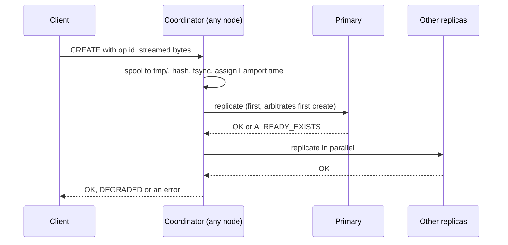

# Architecture

aegisfs is one C++20 binary. `aegisfs serve` runs a storage node and every other subcommand is a
client. There is no leader and no metadata server: each node keeps its own membership table, derives
placement from it, and coordinates whichever requests clients send to it.

The design borrows replicated storage from HDFS and ring placement and gossip from Cassandra, and the
command set follows HyDFS. It shares no code with any of them.

## Components

| Source | Responsibility |
|---|---|
| `src/cli.cpp` | argument handling, `serve`, client commands, interactive `shell` |
| `src/client.cpp` | client library: retries, read-your-writes watermark, striping |
| `src/node.cpp` | RPC server, request handlers, write and read coordination, gossip, failure detection, repair |
| `src/ring.cpp`, `src/hash.cpp` | consistent-hash ring and SHA-256 |
| `src/membership.cpp` | member table, merge rules, state timeouts, wire format |
| `src/storage.cpp`, `src/manifest.cpp` | on-disk segments and per-file manifests |
| `src/replication.cpp` | node-to-node RPCs (replicate, fetch manifest, fetch segment) |
| `src/net.cpp`, `src/protocol.cpp` | TCP, TLS, token check, framing |
| `src/metrics.cpp` | in-process counters and latency samples |
| `src/partition.cpp` | fault injection used only by tests |

## Placement

`ringId(x)` is the top 64 bits of SHA-256(x). `std::hash` is not used because its value may differ
between processes and builds, and every node has to agree on placement.

Each node occupies 64 points on the ring, `ringId(nodeId + "#" + i)` for i from 0 to 63. A file's
replicas are the first `rf` (default 3) distinct nodes at or after `ringId(name)`, wrapping around.
The first of them is the primary. Only members that are currently `ALIVE` are on the ring, so a
suspected node drops out of placement before it is declared failed.

Finding the successors is a binary search. The node does, however, rebuild the sorted ring from its
membership table for each placement decision, so the cost of a decision grows with the number of
nodes. That is acceptable at the tens of nodes this has been run with.

A node's id is `--id`, or a random `node-<16 hex>` if none is given, and is persisted in
`<data>/node.id`. A file id is the 16-hex-digit ring id of its name.

## Membership and failure detection

Each member record holds a node id, address, incarnation number and state: `ALIVE`, `SUSPECT`,
`FAILED` or `LEFT`.

- **Gossip.** Every 300 ms a node sends its whole table to three random live peers and to its seeds,
  and merges the table it gets back.
- **Merge rules.** A higher incarnation wins. At equal incarnation the later state in the order
  above wins, and the address is not changed. A node that hears it is suspected or failed raises its
  own incarnation to refute the rumour.
- **Probing.** Every probe interval (400 ms by default) a node pings each live peer. If the direct
  ping fails it asks up to three other members to ping that peer. Only if none of them can reach it
  is the peer marked `SUSPECT`, so a single broken link does not remove a healthy node.
- **Timeouts.** `SUSPECT` becomes `FAILED` after `--suspect-ms` (1.5 s by default). `FAILED` and
  `LEFT` records are dropped after 30 s.
- **Leave.** `leave` marks the node `LEFT`, hands its files to their new replicas and gossips the
  change. The process keeps running until stopped.

The protocol is modelled on SWIM but is simpler: it pushes full tables rather than piggybacking
updates, and probes every peer each round.

## On-disk layout

```
<data>/
  node.id                      persisted node identity
  files/<fileId>/
    manifest                   committed metadata
    base.seg                   bytes from create
    append-<opId>.seg          one segment per committed append
  tmp/                         staging area
```

Segments are immutable. The manifest lists each segment's kind, operation id, client id, client
sequence, Lamport timestamp, size, SHA-256 and file name, followed by a SHA-256 of the manifest body.

A segment or manifest is written under `tmp/`, fsynced, renamed into place, and the directory is
fsynced. On restart, recovery empties `tmp/`, deletes file directories that have no manifest, and
deletes segments the manifest does not reference. A crash before the manifest commit therefore leaves
the file as it was. `StorageFixture.*` and the `CrashPoints` tests inject a crash at each step.

On macOS the directory flush uses `F_FULLFSYNC`, but file contents are flushed with plain `fsync`,
which does not force them to the physical media there.

## Wire protocol

```
MAGIC "AGFS" (4) | VERSION (2) | TYPE (2) | HEADER_LEN (4) | HEADER | PAYLOAD_LEN (8) | PAYLOAD
```

Integers are little-endian. The header is a list of length-prefixed string key/value pairs, with
numbers written as decimal text. Headers are limited to 16 MiB and payloads to 8 GiB. File payloads
are streamed in 1 MiB chunks. Each connection carries one request and one reply.

Message types are listed in `include/aegisfs/protocol.hpp`: client requests (create, append, get,
merge, ls, listings, status, health, leave, metrics), node-to-node requests (membership, ping,
ping-req, replicate, fetch manifest, fetch segment) and a generic reply.

When a cluster token is configured it travels as the `auth` header on every request, and a node
rejects a request with a missing or different token before reading its payload. TLS 1.2 or newer
wraps the whole stream. [SECURITY.md](../SECURITY.md) describes what these do and do not protect.

A node runs one accept thread, a pool of eight request threads with a bounded queue, and one thread
each for gossip, failure detection and maintenance.

## Writing



The coordinator exists only for the one request. It receives, writes and hashes the upload, using a
second thread for hashing so the three overlap. If it is itself a replica it hard-links the spooled
file into its store. Other replicas receive the segment, verify its SHA-256, and rename their own
spooled copy into place before committing the manifest.

`create` writes the primary first, and the primary rejects a second base with a different operation
id. If the primary write fails, nothing is sent to the other replicas.

`append` first reads the manifest from each reachable replica and takes the union. It returns
`CONFLICT` if two replicas hold different bases, and otherwise assigns the next sequence number for
the client and sends the segment to all replicas in parallel.

| Reply | Meaning |
|---|---|
| `OK` | all `rf` designated replicas committed |
| `DEGRADED` | at least one committed but fewer than `rf`, including when the ring has fewer than `rf` members |
| `UNAVAILABLE` | none committed |

The client retries network errors, timeouts, `UNAVAILABLE`, `DEGRADED` and `STALE`, three attempts
with linear backoff, reusing the same operation id. A node applies an operation id at most once.
Library users can change the attempts and backoff with `Client::setRetryPolicy()`.

## Ordering and read-your-writes

Segments are ordered by: base first, then Lamport timestamp, client id, client sequence and
operation id. This is a total order, so replicas that hold the same operations reconstruct the same
bytes. It follows Lamport time, not wall-clock time. See [Known limitations](../README.md#known-limitations)
for the case where it does not preserve one client's order.

A client records the highest sequence number the cluster has acknowledged to it for each file and
sends it with `get`. The coordinator serves the read only from a replica whose manifest includes it,
and otherwise answers `STALE`. `getQuorum` requires a majority of replicas to qualify and reads the
one with the highest manifest version. Both watermarks and operation counters live in the `Client`
object, so they do not outlive a CLI invocation.

The serving replica verifies every segment checksum before it sends the first byte, so it reads each
file twice, and it holds one segment at a time in memory while sending.

## Convergence and repair

`merge` takes the union of the reachable replicas' manifests, copies missing segments to each, then
compares the SHA-256 of the reconstructed file on every replica. It returns `OK` only if they match,
and `CONFLICT` otherwise.

Each node's maintenance loop runs about once a second:

- **Placement.** For every file it stores, it recomputes the replica set and pushes missing segments
  to designated replicas. If it is no longer one of them, it deletes its copy once the others report
  complete.
- **Integrity.** It checks that each of its segments exists with the recorded size. Once per
  `--scrub-interval-ms` (five minutes by default) it also re-reads and re-hashes the file's segments.
  A missing or corrupt segment is fetched again from a peer.
- **Anti-entropy.** It fetches the peers' manifests and pulls any operation it lacks.

No global file index is involved. The cost is that each node asks the other replicas for a manifest
for every file it stores, on every cycle.

## Striping

A client splits a file larger than `--stripe-mib` (256 MiB by default, 0 disables it) into chunk
files named `<name>.stripe.<client>.<time>.<n>`. Each chunk is an ordinary file, so it is placed,
replicated and repaired like any other. The real name holds a small index of the chunks, written
last, so it is the commit point. A failed create can leave unreferenced chunks behind, and there is
no delete command.

The index's create operation id contains `#stripe#`. A `get` reply says `striped=1` and the client
fetches up to four chunks at a time. A raw `append` to a striped file is refused, and the client then
uploads the new data as chunks and appends their names to the index. `ls`, `merge` and
`getFromReplica` act on the index only.

## Concurrency

A per-file mutex covers the short local step of applying a segment and committing the manifest. No
lock is held across a network call, so two coordinators writing to each other cannot deadlock. There
is no cluster-wide lock.
